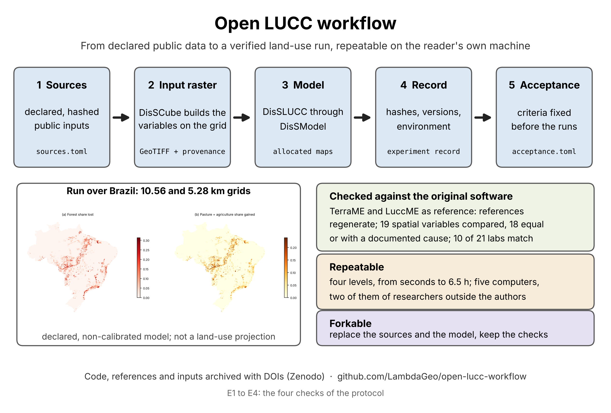

# open-lucc-workflow

<p align="center">
  
</p>

*Overview. The four panels are the four checks of the note, E1 to E4. E1 to E3 are the references and the two benchmarks,
each of which can be repeated on your own machine (the references in a container, the benchmarks with `pip` and `make`);
E4, `make full`, runs the workflow over Brazil on top of the components they verify. The maps in E4 are a verification
run, not a land-use projection.*

Companion repository of the Technical Note (Big Earth Data): an end-to-end, open and traceable
land-use-change workflow in Python (TerraME/LuccME-style), from open data to the allocated maps.
The results cited by the note are those of the tag `v1.1.0` (recorded in `reported/v1.1.0` and `docs/VERSIONS.md`).

**Video.** A video of a level-2 run (`make reproduce-10k`), with the long steps sped up, is at
<https://youtu.be/2ot44-137n8>. It accompanies the note and is not part of the evidence: the records of the
runs are those in `reported/v1.1.0`.

**Purpose.** This repository does not aim to reproduce LuccME-BR. It demonstrates a *process*: how a
land-use-change experiment goes from open data to allocated maps in a way that, once built, anyone
can rerun and check (pinned versions, hashed sources, fixed acceptance criteria, experiment records).
The reproducibility is of the workflow, not of a published model's results.
The approach is open on all three sides: open data (public, hashed sources), open source (every
component and script is public and versioned) and open science (criteria fixed in advance, records
anyone can verify).

> The model here is a **verification model** with declared, synthetic coefficients, used only to
> exercise the workflow. Its maps are not land-use projections and not LuccME-BR outputs.

## One entry point, four checks
This repository is the single entry point: it holds the declared sources, the model, the acceptance criteria and the
record of the reported run (E4), and it points to the other three checks.

| Check | What it shows | Where it lives |
|---|---|---|
| E1. References | The TerraME/LuccME references can be regenerated from a pinned container | [terrame-docker](https://github.com/LambdaGeo/terrame-docker) 0.4.2 (DOI 10.5281/zenodo.23160784); the references are in [luccme-goldens](https://github.com/LambdaGeo/luccme-goldens) 1.1.0 (DOI 10.5281/zenodo.23161342) |
| E2. Spatial parity | DisSCube derives the same variables as the TerraME Fill from the same raw layers | [disscube-benchmark](https://github.com/LambdaGeo/disscube-benchmark) 1.1.0 (DOI 10.5281/zenodo.23366475) |
| E3. Dynamic parity | DisSLUCC reproduces the LuccME laboratories of luccme-goldens | [disslucc-benchmark](https://github.com/LambdaGeo/disslucc-benchmark) 0.2.2 (DOI 10.5281/zenodo.23224097) |
| E4. The workflow over Brazil | The whole chain, from declared sources to allocated maps, meets criteria fixed in advance | this repository (`make full`) |

The levels below are the ways of repeating E4.

## Check the result quickly
You do not need to run the six-and-a-half-hour computation to check the work. Pick the level you have time for:

| Level | Command | Time | What it shows |
|---|---|---|---|
| 0. Audit the record | `make check-reported` | seconds | The reported runs meet the criteria of `acceptance.toml`, from their recorded metrics (no model run) |
| 1. Smoke test | `make small` | about 15 s | The pipeline runs offline on a synthetic raster and a repeat run is identical |
| 2. Reproduce on real data | `make reproduce-10k` | about 40 min (39 min measured) | Builds the 10.56 km grid from the open sources, runs the model and prints `OK` or `DIFFERS` against the reported run (same input and output SHA-256) |
| 3. Full run of the authors | `make full` | about 6.5 h | Both grids, the repeat run at 5.28 km and the three acceptance checks |

Level 2 is the check we ask of a reviewer. The 5.28 km run (level 3) shows that the same chain scales to 307,000
cells; its results are archived in `reported/`. After `make reproduce-10k`, `OK ... identical` means the same
input raster and the same output bytes as the reported run. `OK ... numerically equivalent` means the same input
raster and class areas that agree to 1e-6 of the mapped area, which can happen across operating systems or
library builds (see Windows below); `DIFFERS` prints what differs, including the installed package versions.
On a platform other than x86-64 Linux or WSL2, read `DIFFERS` with the section "Platforms" below before
concluding that a run is wrong.

## Workflow stages (E4)
Five stages, each leaving a named artifact that a check reads:
1. **Sources** — the open data are declared with URL and SHA-256 in `pipeline/grid/sources.toml` and fetched and verified by `disscube fetch`.
2. **Input raster** — `disscube` derives the named bands on the Brazil Data Cube grid (5.28 km and 10.56 km;
   `pipeline/grid/derivations.template.toml`); `scripts/complete_input.py` completes the cells and `scripts/check_input.py` validates bands, CRS and mask.
3. **Model** — the DisSLUCC saturation executor with `model/verification_model.toml` and `model/scenario.toml`; the demand is derived from the input raster (`scripts/make_demand.py`).
4. **Record** — each run writes an experiment record and `metrics.json`; `scripts/verify_record.py` checks the hashes and the pinned versions.
5. **Acceptance** — `scripts/check_run.py` against `acceptance.toml` (demand met, identical repeat run, class areas agree across resolutions); `make report` writes `results/table4.md`.

## Use
`make` is a convenience: each target is a list of commands (see "Using the packages without `make`" below).
On a fresh Ubuntu or Debian (also inside WSL2) install the tools first: `sudo apt update && sudo apt install -y make git python3 python3-pip python3-venv`. Python 3.11 or newer is required (Ubuntu 24.04 has 3.12; Ubuntu 22.04 and 20.04 have 3.10 and 3.8, and `make env` stops with a message in that case).
```
make env            # .venv with pinned packages
make small          # offline, synthetic input raster (~15 s); what CI runs
make grids          # only the two grids (10.56 and 5.28 km) from open data; no model run
make grid-10k       # or one at a time: data/br_10km.tif (~1 min)
make grid-5k        # data/br_5km.tif (~3 min, peak ~1 GB RAM)
make run-10k        # grid + model at 10.56 km only (runs/br_10km)
make run-5k         # grid + model at 5.28 km only (runs/br_5km)
make reproduce-10k  # the reviewer's path: 10.56 km grid and model (about 40 min), compared with the reported run
make check-reported # audit of the reported runs against acceptance.toml from their metrics (seconds)
make full           # grids + model runs + checks + report (network; the 5.28 km model run is the heavy step)
make test lint
```
`make full` refuses to report unless `acceptance.toml` is frozen. Open decisions and pinned
versions/DOIs: `docs/VERSIONS.md`.

## Using the packages without `make`
`make` only chains commands. DisSCube and DisSLUCC are used through declared (TOML) files and their own commands; the
repository adds the steps that are specific to this experiment and its checks. A similar chain for another study needs the
second column below and your own declared files.

| Stage | Command of the packages | Added by this repository |
|---|---|---|
| 1. Sources | `disscube validate`, `disscube fetch` on `pipeline/grid/sources.toml` | none |
| 2. Input raster | `disscube run` on `sources.toml` and on `derivations.template.toml`, then `disscube export` | `scripts/render_pipeline.py` (the two grids from the template), `scripts/complete_input.py` (cells without every band leave the mask), `scripts/check_input.py` |
| 3. Model | `python -m disslucc.executors.saturation run` | the demand table (`scripts/make_demand.py`), the parameters file (`scripts/make_parameters.py`, run by hand: `model/verification_model.toml` is already in the repository), `scripts/run_experiment.py` (time, peak memory, `metrics.json`) |
| 4. Record | written by the executor (experiment record, JSON) | `scripts/verify_record.py` |
| 5. Acceptance | none | `acceptance.toml`, `scripts/check_run.py`, `scripts/check_expected.py`, `scripts/report.py` |

The scripts of the last row are the checks of the note, not conveniences; `scripts/README.md` describes every script by use. The commands follow the Makefile, which first writes the `[grid]` block with `scripts/render_pipeline.py`; `derivations.template.toml` is already the 10.56 km grid, and the 5.28 km grid changes only that block:

```
disscube validate pipeline/grid/sources.toml     # no network: checks the declaration
disscube fetch    pipeline/grid/sources.toml     # downloads each file and checks its SHA-256
disscube run      pipeline/grid/sources.toml --workspace data/cube
disscube run      pipeline/grid/derivations.template.toml --workspace data/cube
disscube export   pipeline/grid/derivations.template.toml --workspace data/cube --output data/raw_br_10km.tif

python -m disslucc.executors.saturation run \
    --toml model/verification_model.toml --input data/br_10km.tif \
    --param demand_csv=demand.csv --param cell_area=111.5136 \
    --param n_steps=15 --param max_difference=1000.0 --output out.tif
```
The reported record was made with the input raster that `scripts/complete_input.py` writes from the exported one and with the
demand table of `scripts/make_demand.py`, so its hashes hold for the path of the Makefile; the commands above do not reproduce them by themselves.

## Fork and adapt
The model here is a demonstration: its data, weights and scenario are declared, not estimated, and nothing in the note
depends on them. The repository is meant to be forked. Change one thing at a time and repeat the check after each change.

1. **Confirm the baseline.** Fork the repository, then run `make check-reported` and `make small`. The record in `reported/v1.1.0` is the reference for your changes.
2. **Change the inputs.** Edit the declared sources (`pipeline/grid/sources.toml`, with the URL and SHA-256 of each layer) and the derivations that name the operator of each variable (`pipeline/grid/derivations.template.toml`); rebuild with `make grids`. The provenance record and the hashes follow the change.
3. **Change the parameters and the scenario.** Edit the weights (`model/parameter_weights.toml`) and the scenario (`model/scenario.toml`: years, tolerance and demand per class); `scripts/make_parameters.py` regenerates `model/verification_model.toml` from them.
4. **Change the components.** DisSLUCC has no component registry: each executor builds its demand, potential and allocation explicitly (see `disslucc/executors/saturation.py`). To use another one, write a class that follows the protocols in `disslucc/protocols.py` (examples in `disslucc/components/`), build it in an executor that subclasses `LuccExecutorBase`, and run that executor in place of the saturation one in `scripts/run_experiment.py`.
5. **Write the criteria before the run.** Edit `acceptance.toml` for your case and freeze it, run `make reproduce-10k` or `make full`, and let `scripts/check_run.py` say whether the criteria are met. Share the fork with its record so that others can repeat your run.

## Windows
The workflow is developed and tested on Linux. On Windows, use **WSL2** (Ubuntu), which gives the same
environment, and keep the repository inside the Linux file system (`~/`), not under `/mnt/c`:
```
wsl --install -d Ubuntu-24.04     # PowerShell as administrator; restart when asked (an older Ubuntu already installed has Python 3.8 or 3.10, which is too old)
# then, in the Ubuntu terminal:
sudo apt update && sudo apt install -y make git python3 python3-pip python3-venv
git clone https://github.com/LambdaGeo/open-lucc-workflow && cd open-lucc-workflow
make env && make small
```
For `make full` give WSL2 enough memory (the 5.28 km model run is the heavy step): create
`%UserProfile%\.wslconfig` with `[wsl2]` and `memory=8GB`, then run `wsl --shutdown`.

Native Windows (PowerShell or cmd) is **not supported**: the `Makefile` calls POSIX shell commands and the
virtual environment is looked up in `.venv/bin`. The repository sets `eol=lf` in `.gitattributes`, so a
checkout on Windows does not change the line endings, and with them the SHA-256, of the declared files.

## Platforms
Level 2 (`make reproduce-10k`) was run on five computers. On four of them, all x86-64 (Linux and Windows with
WSL2), the SHA-256 of the input and output rasters are those of the reported run and the command prints
`OK ... identical`. The fifth was a Mac with an Apple M3 processor (arm64, macOS 26.5.1, Python 3.13.5), run by
a researcher outside the authors. All four acceptance criteria passed there, and the iteration counts of the 14
allocations, the largest error of each year and the final area of the seven classes were equal to those of the
reported run, but the command printed `DIFFERS`, because the checksums of the two GeoTIFF files differ. A
cell-by-cell comparison with a run on Linux showed that:

- the values of the output raster are equal in every cell and band; the bytes differ because each platform's
  GDAL writes the DEFLATE compression differently (the strips are identical once decompressed);
- the input raster differs in one value out of 1,549,332 (about 1.8e-12, one unit in the last place of a
  32-bit float), which changes its checksum and, with it, that of the output;
- before the conversion to 32 bits, the raw raster (64 bits) differs in about 47% of its values by floating-point
  noise (at most 3.1e-12 in the shares and 5.3e-8 m in the distances), with equal masks. We did not collect the
  versions of GDAL, GEOS and PROJ on the two platforms, so we do not know which library produces it.

So `DIFFERS` on a platform other than x86-64 Linux or WSL2 does not by itself mean that the run is wrong.
Compare the iteration counts, the largest error per year and the class areas in the log with
`reported/v1.1.0`, and, if you have the two rasters, compare their values:

```bash
python scripts/compare_rasters.py runs/br_10km/<output>.tif other_computer/<output>.tif
```

The check of `make reproduce-10k` compares hashes of files, not of values, and we kept it that way so that
the released record stays as it was archived. To repeat levels 0 to 2 on your own computer and collect the
logs, the machine description and the package versions in one file that you can send to us, run
`scripts/external_check.sh` in an empty folder (Linux, WSL2 or macOS).

**On a Mac:** the commands are the same (Python 3.11 or newer, for example `brew install python@3.12` and
`make env PYTHON=python3.12`; `make` and `git` come with the Xcode command-line tools). Levels 0 and 1 pass, and
level 2 is expected to end with `DIFFERS`. Read it as different bytes in the files, not as a failed run: compare
`runs/br_10km/metrics.json` with `reported/v1.1.0/metrics_br_10km.json` (iterations, largest error per year and
class areas) and, to compare values, the rasters with `scripts/compare_rasters.py`.

On macOS older than 15, `pip` may not find a binary wheel of `rasterio` for Apple Silicon and try to build it,
which needs GDAL installed on the system; this was not tested here.

## Cite
Costa, S. S., Bezerra, D. da S., & Alves, J. M. P. (2026). *Open LUCC workflow: traceable land-use change modelling from open data* (Version v1.1.0) [Computer software]. Zenodo. https://doi.org/10.5281/zenodo.23415814

## Licences
The source code is under the MIT licence (`LICENSE`). The results, metrics, reports and run records that the repository produces or stores are under CC BY 4.0, to the extent of our rights (`LICENSE-DATA`). The input layers are not ours: each follows the terms of its source (`docs/DATA.md`). The copies of three layers in the GitHub release `data-preview` keep the terms of their sources. This is not legal advice.

## Status
`make small` and `make full` have been run (Linux, Python 3.12.3); `make reproduce-10k` was repeated on four more computers, one of them a Mac (see Platforms). `make full` took 6 h 31 min: the 5.28 km model run took
173 min (794 MB) and the 10.56 km run 36 min (384 MB). The three acceptance checks pass; the hashes of the input rasters and of
the outputs are in `docs/VERSIONS.md`, and the record is in `reported/v1.1.0`.
